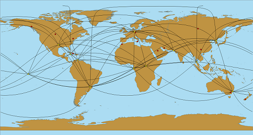

Beeline
================
A simple QGIS processing plugin that creates lines along great circles to connect a set of input points.

Works well for up to a few hundred input points (save your project and edits if you test limits!)

Examples:

License
-------------
This program is free software; you can redistribute it and/or modify
it under the terms of the GNU General Public License as published by
the Free Software Foundation; either version 2 of the License, or
(at your option) any later version.